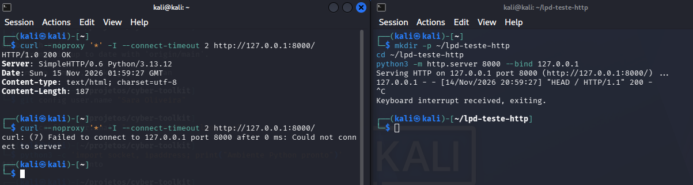

# TCP scanner notes

## Source and adaptation

The scanner was adapted from the TCP port scanning example in *Python
Penetration Testing Essentials* by Mohit (2015). I adapted the example to
Python 3 and tested it with a local HTTP server on Kali Linux, comparing
the results with the server running and stopped.

## Test evidence

I used `curl` to confirm that the local HTTP server responded on
`127.0.0.1:8000` while running and stopped accepting connections after
I shut it down.

I then ran my Python script against the same IP and port. It returned `0`
with the server running and `111` on Kali Linux after I stopped it,
confirming that the connection was refused in the second run.

## Bibliographic reference

Mohit. (2015). *Python Penetration Testing Essentials*. Packt Publishing.
First published January 2015. ISBN: 978-1-78439-858-3.
