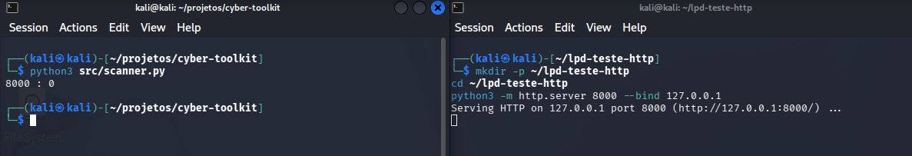
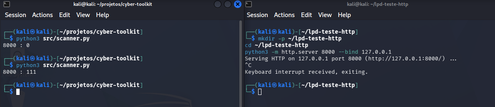
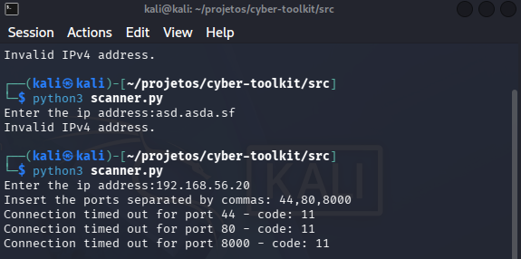
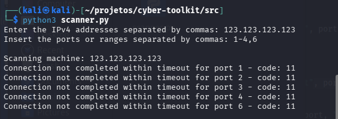

# TCP scanner notes

## Source and adaptation

The scanner was adapted from the TCP port scanning example in *Python
Penetration Testing Essentials* by Mohit (2015). I adapted the example to
Python 3 and extended it with IPv4 validation, port validation, port
ranges, multiple hosts, and readable connection status messages.

## Initial test — 15 November 2026
Python 3 and tested it with a local HTTP server on Kali Linux, comparing
the results with the server running and stopped.

## Test evidence

I used `curl` to confirm that the local HTTP server responded on
`127.0.0.1:8000` while running and stopped accepting connections after
I shut it down.

I then ran my Python script against the same IP and port. It returned `0`
with the server running and `111` on Kali Linux after I stopped it,
confirming that the connection was refused in the second run.

## Improvements — 21 November 2026

- Accept multiple IPv4 addresses separated by commas.
- Validate IPv4 addresses and port numbers.
- Accept individual ports and inclusive ranges, such as `22,8000-8002`.
- Display readable connection status messages.
- Use a three-second timeout for each connection attempt.
- Close each socket after the attempt.

## Additional test evidence

### Invalid IPv4 address

The scanner rejected an invalid IPv4 address. This screenshot shows
an earlier version of the input prompt.

### Port range and connection timeout

The input `1-4,6` produced attempts on ports `1`, `2`, `3`, `4`, and `6`.
Each attempt returned code `11` on Kali Linux without completing within
the configured timeout.

## Bibliographic reference

Mohit. (2015). *Python Penetration Testing Essentials*. Packt Publishing.
First published January 2015. ISBN: 978-1-78439-858-3.
